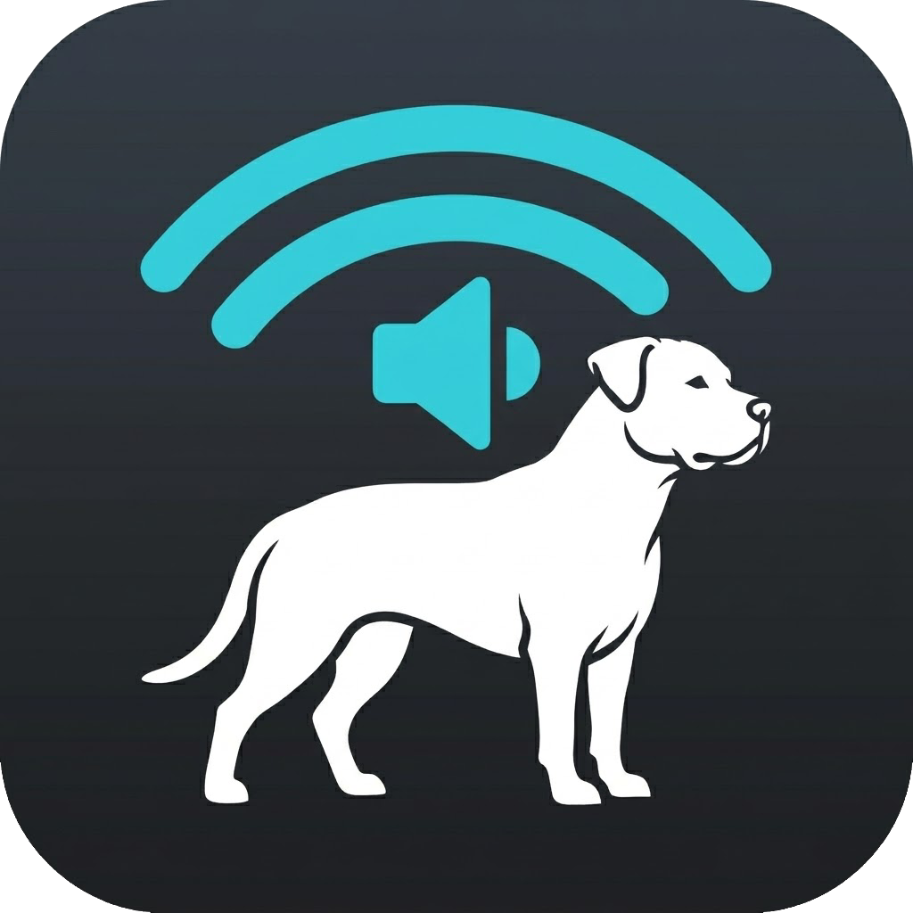
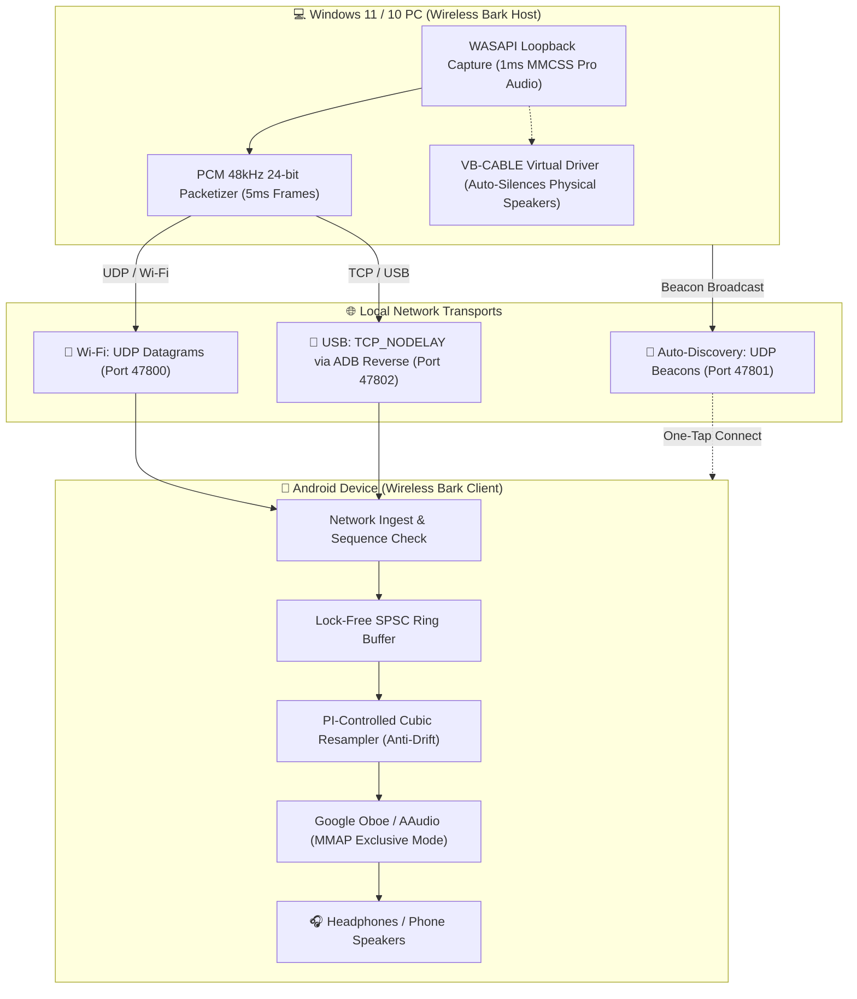

<div align="center">



# 🐕 Wireless Bark
### Ultra-Low Latency PC-to-Android Audio Streaming Suite (Wi-Fi & USB)
**Created and Published by [TAB inc.](https://github.com/Tr1pAc1d)**

[](https://github.com/Tr1pAc1d/Wireless_Bark/releases)
[](LICENSE)
[](PRIVACY.md)
[_&_USB_(ADB)-f59e0b?style=for-the-badge)]()
[](https://github.com/Tr1pAc1d/Fetch)

<p align="center">
  <b>Stream crystal-clear, near-zero latency audio from your Windows PC directly to your Android device over local Wi-Fi or wired USB.</b><br/>
  <i>No accounts. No subscriptions. No ads. No telemetry. 100% local operation.</i>
</p>

</div>

---

## 💡 Overview

**Wireless Bark** transforms your Android phone or tablet into an ultra-responsive wireless audio receiver for your Windows computer. Whether you want to listen to music, watch movies without audio desync, play PC games from across the room, or wear headphones connected to your phone while keeping your PC speakers silent, Wireless Bark delivers studio-grade response times.

- **Zero Bloat, Pure Speed:** Operates on raw PCM audio buffers running on high-priority MMCSS Pro Audio and native Android Oboe/AAudio MMAP threads.
- **Auto-Silencing PC Speakers:** Automatically switches Windows playback to the bundled VB-CABLE virtual driver upon connection, silencing your physical speakers without manual toggling, and seamlessly restores them on disconnect.
- **Sister Project:** Like our sister software **[Fetch](https://github.com/Tr1pAc1d/Fetch)** (the ultra-low latency wireless trackpad & gamepad for PC), Wireless Bark is built on the **TAB inc.** user pledge: **Zero trackers, zero data collection, no ads, and no payment walls.**

---

## 📦 Downloads & Installation

### 🖥️ STEP 1: Get the Windows Suite (On Your PC)

| Package | Direct Download Link | Size | Description |
| :--- | :--- | :--- | :--- |
| **Windows 11 / 10 Installer** (Recommended) | **[📥 WirelessBark-Setup.exe](https://github.com/Tr1pAc1d/Wireless_Bark/releases/download/v1.0.0/WirelessBark-Setup.exe)** | ~12.2 MB | Traditional Windows Install Wizard. Bundles the app, Terms of Service, desktop shortcuts, and silent VB-CABLE driver auto-install. |
| **Windows Portable (No Install)** | **[📥 WirelessBark-Portable.zip](https://github.com/Tr1pAc1d/Wireless_Bark/releases/download/v1.0.0/WirelessBark-Portable.zip)** | ~4.5 MB | Standalone portable bundle. Runs directly into your system tray with zero install. |

---

### 📱 STEP 2: Get the Android Client (On Your Phone / Tablet)

| Package | Direct Download Link | Size | Description |
| :--- | :--- | :--- | :--- |
| **Android APK** (Standard) | **[📥 WirelessBark.apk](https://github.com/Tr1pAc1d/Wireless_Bark/releases/download/v1.0.0/WirelessBark.apk)** | ~26.5 MB | Full Android client featuring Jetpack Compose UI and native C++ Oboe/AAudio low-latency engine. |
| **1-Click ADB Phone Installer** | **[📥 install-to-phone.bat](https://github.com/Tr1pAc1d/Wireless_Bark/releases/download/v1.0.0/install-to-phone.bat)** | ~1 KB | Automated batch script that detects your plugged-in USB phone via ADB and installs the APK in one click. |

> 🏷️ All release binaries, source archives, and checksums are also hosted on the official **[GitHub Releases Page](https://github.com/Tr1pAc1d/Wireless_Bark/releases)**.

---

## ✨ Features at a Glance

### ⚡ Near-Zero Latency Sound Engine
* **Windows MMCSS "Pro Audio" Loopback:** Captures WASAPI loopback samples with 1 ms polling intervals and packs them into 5 ms low-jitter datagrams on an elevated OS audio scheduling thread.
* **Android Oboe / AAudio Native Engine:** Direct C++ implementation (NDK) utilizing MMAP Exclusive mode to bypass Android's legacy AudioFlinger mixing mixer completely.
* **Drift-Correcting Cubic Resampler (PI Controller):** Continuously measures hardware clock divergence between your PC and Android DAC, dynamically resampling on the fly to eliminate buffer growth and audio underruns with zero clicks or pitch modulation.
* **Lock-Free SPSC Ring Buffer:** Zero-allocation, thread-safe memory ring buffer between network ingest and audio render callbacks.

### 🔇 Smart Speaker Silencing (VB-CABLE Integration)
* **Automatic Endpoint Switching:** When your Android device connects, Wireless Bark automatically switches the default Windows playback device to VB-CABLE, preventing audio from blasting out of your computer's physical speakers.
* **Instant Auto-Restoration:** As soon as you disconnect or exit the app, your physical speakers and volume levels are instantly restored.
* **Crash & Reboot Protection:** Stores your original hardware configuration so your sound settings are restored even if the PC unexpectedly shuts down or restarts.
* **Mute Fallback:** If VB-CABLE is not installed, Wireless Bark cleanly mutes the physical endpoint while streaming and unmutes upon disconnect.

### 📶 Dual Connection Modes (Wi-Fi & USB)
* **Wi-Fi Mode (High-Speed UDP):**
  * Transmits lightweight UDP datagrams directly over your local router.
  * Requests Android `WIFI_MODE_FULL_LOW_LATENCY` lock and a partial `WakeLock` to prevent mobile OS power-throttling during playback.
* **USB Mode (ADB Reverse Tunnel - Ultimate Consistency):**
  * Connect your phone to your PC via a standard USB cable.
  * The Windows tray app automatically provisions `adb reverse tcp:47802 tcp:47802` with socket `TCP_NODELAY`.
  * Delivers a rock-solid, interference-free **25–40 ms total latency pipeline**, immune to Wi-Fi channel congestion.

### 📡 Zero-Config Auto-Discovery
* PC broadcasts lightweight discovery beacons on UDP port `47801`.
* Opening the Android app automatically detects all running PCs on your local Wi-Fi network with one tap to connect.

### 📊 Live Real-Time Telemetry HUD
* Real-time monitoring of:
  * End-to-end latency (ms)
  * Jitter buffer depth & hardware output delay
  * Round-Trip Time (RTT)
  * Clock drift (PPM)
  * Packet loss rate and audio underruns
* **Interactive Jitter Tuning Slider:** Tune on the fly between **Lowest Latency (5 ms)** for gaming and **High Stability (60 ms)** for weak Wi-Fi coverage.

---

## 🏗️ Architecture & Communication Pipeline



---

## 🚀 Quick Start Guide

### Wi-Fi Mode (Wireless)
1. **Launch on PC:** Open `WirelessBark.exe` or install via `WirelessBark-Setup.exe`. The dog icon will appear in your system tray.
2. **Launch on Android:** Open the Wireless Bark app on your phone.
3. **Connect:** Your PC will appear in the list under **Discovered PCs on Wi-Fi**. Tap **Connect**!
4. Put on your headphones and enjoy instant, synchronized PC audio.

### USB Mode (Lowest Latency & Maximum Stability)
1. Plug your Android phone into your PC with a USB cable.
2. Enable **USB Debugging** in your phone's *Settings → Developer Options*.
3. In the Android app, switch the mode to **USB (ADB Tunnel)** and tap **Connect over USB**.
4. Wireless Bark automatically handles the ADB port reversal and initiates the zero-jitter stream!

---

## 🐾 Sister Project: Fetch

If you love clean, bloat-free tools that respect your privacy, check out our companion project:

👉 **[Fetch by TAB inc.](https://github.com/Tr1pAc1d/Fetch)**  
*Turn your Android smartphone, tablet, or Steam Deck into a zero-latency wireless trackpad, keyboard, and living room couch remote for your computer!*

---

## 🛡️ TAB inc. Privacy Guarantee & Terms

* **100% Local Operation:** All audio and control packets travel exclusively within your local home network or USB cable. Nothing ever touches the internet or an external server.
* **Volatile RAM Only:** Audio is streamed directly in memory and is **never recorded, never saved to disk, and never stored**.
* **Zero Telemetry:** No tracking beacons, no analytics, no advertising IDs, no crash uploaders, no third-party SDKs.
* **Zero Accounts:** No sign-ups, passwords, logins, subscriptions, or paywalls.
* Full details: [`PRIVACY.md`](PRIVACY.md) and [`installer/TERMS.txt`](installer/TERMS.txt).

---

## 🛠️ Building from Source

### Prerequisites
- Windows 10/11 with [.NET 8.0 SDK](https://dotnet.microsoft.com/download)
- Android Studio with Android NDK (r25c+) & CMake
- [Inno Setup 6](https://jrsoftware.org/isdl.php) (optional, for compiling the installer)

### Windows PC Suite
```powershell
cd windows
dotnet build AudioBridge.sln -c Release
```
The compiled executable will be located at:  
`windows\AudioBridge.Tray\bin\Release\net8.0-windows\WirelessBark.exe`

### Android Client
```bash
cd android
./gradlew assembleRelease
```
The compiled APK will be located at:  
`android/app/build/outputs/apk/release/app-release-unsigned.apk`

### Windows Installer
```powershell
iscc.exe installer\WirelessBark.iss
```
The compiled setup wizard will be generated at:  
`release\WirelessBark-Setup.exe`

---

## 📜 License
Copyright &copy; 2026 **TAB inc.** All Rights Reserved.  
Proprietary software. Unauthorized copying, distribution, modification, reverse engineering, or commercial use is strictly prohibited. See [`LICENSE`](LICENSE) for complete terms.

**Wireless Bark** is proudly built and maintained by **TAB inc.** 🐕
